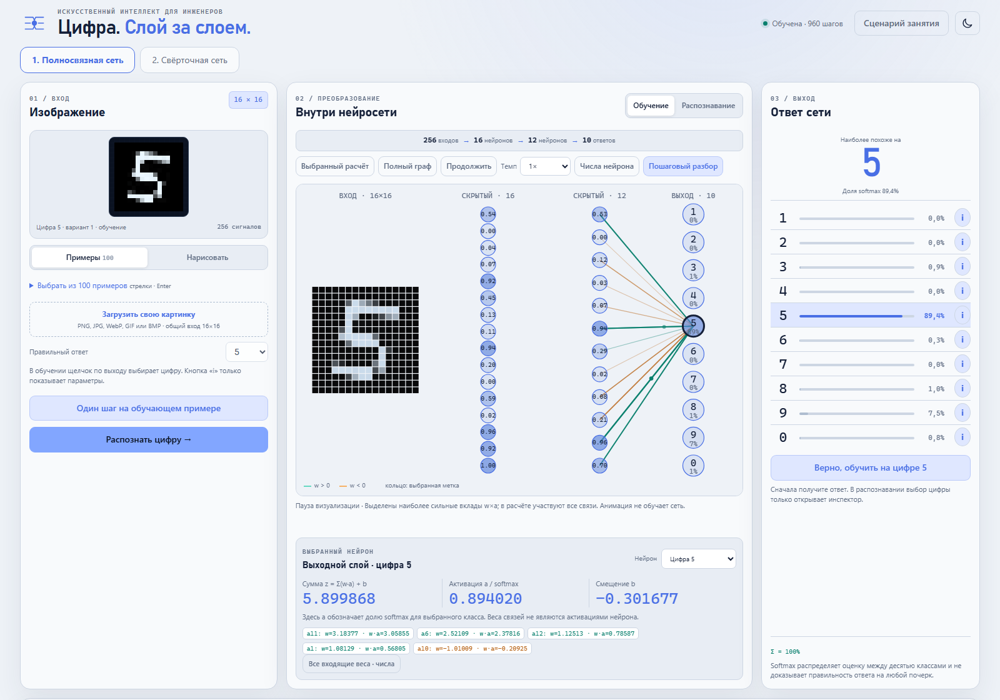
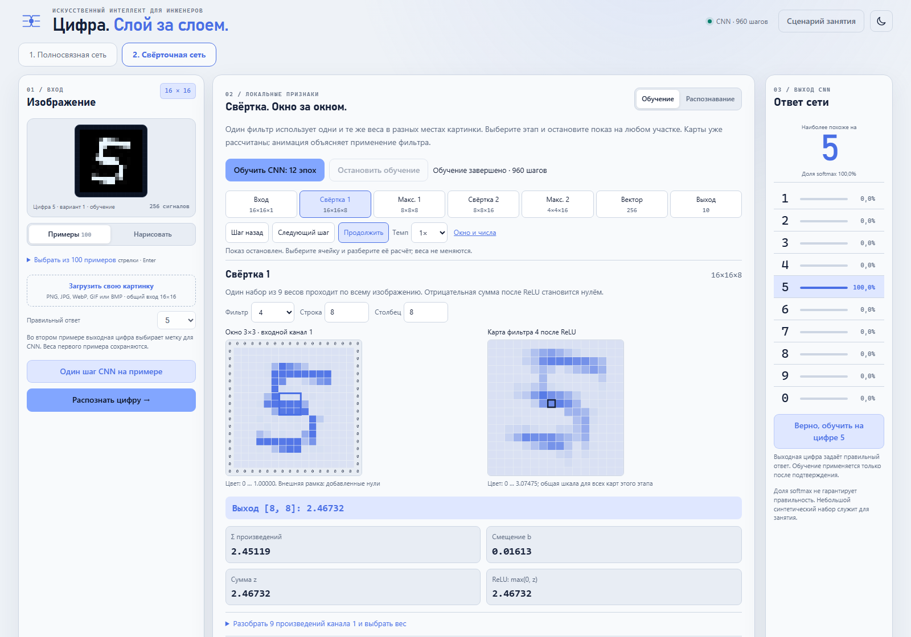

# Цифра. Слой за слоем

Учебная лаборатория для курса **«Искусственный интеллект для инженеров»** с двумя примерами: полносвязной сетью (MLP) и свёрточной сетью (CNN). Слева общий рисунок 16×16, в центре расчёт выбранной сети, справа ответы `1, 2, 3, 4, 5, 6, 7, 8, 9, 0`. Прогноз и обучение вычисляются в браузере; показанные веса и активации берутся из расчёта.

Кнопки «1. Полносвязная сеть» и «2. Свёрточная сеть» переключают пример, сохраняя рисунок. У каждой сети свои веса, шаги обучения, история, сохранение и режим. Можно сравнить два ответа на один вход.

Полносвязная сеть: граф связей, активации и выходы.



Свёрточная сеть: карты признаков и вычисление выбранного окна.



## Установка

Нужен Node.js 20 или новее. Для нового компьютера выбирайте поддерживаемую LTS-версию с [официального сайта Node.js](https://nodejs.org/en/download).

Исходники: [pikov-vitaliy/neural-network-digit-recognition](https://github.com/pikov-vitaliy/neural-network-digit-recognition). Запуск версии 1.0.0 из npm одной командой:

```powershell
npx -y neural-network-digit-recognition@1.0.0
```

Альтернатива из публичного GitHub-репозитория по тегу `v1.0.0`:

```powershell
npx -y github:pikov-vitaliy/neural-network-digit-recognition#v1.0.0
```

Вторая команда получает пакет **из GitHub**, а не из npm registry; для неё дополнительно нужен Git. Для курса используйте согласованную фиксированную версию. Первый запуск требует доступа к источнику, затем изображения и расчёт сети находятся локально.

Локальный архив создаётся командой `npm pack`. После передачи архива студенту:

```powershell
npx --yes --offline --package=./neural-network-digit-recognition-1.0.0.tgz neural-network-digit-recognition
```

## Запуск из исходников

Нужен браузер с Canvas. Обязательных npm-зависимостей и сборки нет. В PowerShell, открытом в папке проекта:

```powershell
npm start
```

Браузер открывается автоматически. Сервер слушает только `127.0.0.1`; начальный порт 4173. При занятости проверяется до десяти последовательных портов в пределах 0–65535. **Остановка: Ctrl+C в том же терминале.** Закрытие вкладки не останавливает сервер.

```powershell
npm start -- --no-open --port 0
```

`--port 0` выбирает свободный системный порт. `--no-open` и непустая переменная `CI` отключают открытие браузера. Также доступны `--port N`, `--port=N`, `--help`, `--version`. Подкоманда `web` не нужна.

## Нарисовать, распознать, исправить

1. Выберите пример MLP или CNN. В режиме **«Обучение»** выберите «Нарисовать», изобразите цифру и нажмите «Распознать цифру».
2. Если ответ верен, нажмите «Верно, обучить на цифре N»: эта кнопка сама подтверждает один шаг обучения, без дополнительного диалога. Если ответ неверен, выберите правильную цифру справа; в MLP можно также выбрать выходной нейрон. Список «Правильный ответ» остаётся альтернативой.
3. При исправлении ответа проверьте целевую цифру в диалоге и нажмите «Да, обучить» для MLP или «Да, обучить CNN» для CNN. До подтверждения веса не меняются. Одно подтверждение выполняет один шаг; «Отмена» оставляет модель прежней. Рисунок сохраняется.
4. В MLP кнопка `i` рядом с цифрой открывает параметры нейрона. В CNN выберите этап расчёта и нужный канал или ячейку. Просмотр параметров не обучает сеть.

Смена входа отменяет неподтверждённый ответ. Проверочные встроенные примеры не используются для обучения. В **«Распознавании»** обучающие действия отключены: выбор входа и инспекция не меняют веса.

## Полносвязная сеть на занятии

- **Один пример.** Разбор шага показывает вход, сумму `z`, активацию `a`, loss, градиент и изменение выбранного веса. Этапы можно переключать и останавливать. Таблица сопоставляет `w_old`, `η`, `gradient`, `Δw` и `w_new`. План не изменяет модель до отдельного применения шага.
- **Анимация.** После распознавания движение повторяет прямой проход текущего входа до смены входа или модели. «Пауза» и «Темп» управляют показом, а не обучением. При `prefers-reduced-motion` сохраняется статическое выделение.
- **Связи и числа.** «Выбранный расчёт» помогает разобрать вклад, «Полный граф» показывает всю структуру. «Все входящие веса · числа» открывает таблицу выбранного нейрона. Вес `w`, активация `a` и смещение `b` обозначают разные величины.
- **Эпохи.** «Быстро обучить: 12 эпох» использует 80 обучающих примеров. Ещё 20 отложены от SGD и используются для проверки. История показывает метрики завершённых эпох.

В полносвязной сети участвуют все связи. Выделение сильных вкладов не означает исключение остальных. Анимация сама по себе не меняет веса или вероятности.

## Свёрточная сеть на занятии

CNN показывает, как один фильтр использует одинаковые веса в разных местах картинки. Выберите этап: вход, первая свёртка, первый pooling, вторая свёртка, второй pooling, flatten или выход. Затем выберите канал и позицию. В свёртке видны исходное окно, произведения на веса, сумма со смещением и результат ReLU. Во втором слое расчёт включает все восемь входных каналов. В max pooling видны четыре исходные ячейки и выбранный максимум; в flatten их значения переходят в одномерный вектор.

Числа инспектора относятся к тому же сохранённому прямому проходу, что и карты признаков. Снимок содержит вход, параметры и промежуточные результаты; последующие вычисления не подменяют числа уже показанного прохода. Смена входа, импорт и сброс очищают показанный ответ. Для нового расчёта нажмите «Распознать цифру».

«Обучить CNN: 12 эпох» использует те же 80 обучающих примеров. Кнопка «Остановить обучение» прерывает цикл между шагами. Исправление отдельного ответа требует подтверждения «Да, обучить CNN» и применяет один шаг SGD. Проверочные 20 примеров и режим «Распознавание» веса не меняют.

## Сохранение и изображения

MLP и CNN сохраняют модели и истории в отдельных записях `localStorage`. У MLP доступны «Экспорт», «Импорт» и «Сбросить»; у CNN отдельные «Экспорт CNN», «Импорт CNN» и «Сбросить CNN». Экспорт записывает параметры и число шагов в JSON. Импорт проверяет тип, размеры и числа перед заменой модели; JSON другой архитектуры отклоняется. История эпох после импорта начинается заново.

Сброс требует подтверждения и возвращает случайные веса только выбранной сети. Другая сеть, общий рисунок и экспортированные файлы остаются. Переключение примера также не переносит веса между архитектурами.

Хранилище привязано к адресу **включая порт**. На другом порту, в другом браузере или после очистки его данных сохранение не появится. Для переноса используйте экспорт/импорт.

Загружаются PNG, JPG, WebP, GIF и BMP. Вход приводится к 16×16, светлый фон инвертируется. Для сравнения с галереей используйте PNG из `public/samples/`. Пустое изображение не следует выдавать за распознанную цифру.

## Архитектуры и ограничения

**MLP:** слои 256, 16, 12 и 10 нейронов; 4 408 весов и 38 смещений. Скрытые слои используют sigmoid, выход softmax. `η = 0,35` для одного шага, `η = 0,3` для автоматического цикла.

**CNN:** вход 16×16×1; свёртка 3×3 с 8 фильтрами и ReLU; max pooling 2×2; свёртка 3×3 с 16 фильтрами и ReLU; max pooling 2×2; flatten из 256 значений; 10 выходов softmax. Нулевое дополнение сохраняет размер при свёртке. Всего **3 818 параметров: 3 784 веса и 34 смещения**. `η = 0,03` для одного шага и цикла эпох.

Обе сети обучаются backpropagation и SGD. Cross-entropy вычисляется по логитам. В [ядре CNN](src/shared/cnn-network.js) используется cross-correlation без переворота ядра. [Численные тесты](test/cnn-network.test.js) проверяют окно свёртки, максимум pooling, формы тензоров, градиенты и независимость снимков расчёта.

Генератор с seed `20261114` создаёт 100 детерминированных grayscale PNG 16×16: десять вариантов каждой цифры, два начертания, сдвиги, повороты, различия толщины и шум. Manifest содержит те же исходные пиксели. Набор создан кодом проекта, внешний MNIST в базовом примере не используется.

Контрольные браузерные прогоны после сброса и 12 эпох (960 шагов) на комплектных синтетических данных:

| Модель | Обучение, 80 примеров | Validation, 20 примеров | Loss на обучении |
| --- | --- | --- | --- |
| MLP | 90% | 75% (15 из 20) | 0,256554 |
| CNN | 100% | 100% (20 из 20) | 0,004967 |

Скорость обучения CNN выбрана с учётом validation. Отдельного test-набора нет: эти 20 изображений не дают независимой оценки обобщения. Результаты не гарантируют распознавание произвольного почерка. Точность зависит от архитектуры, начальных весов, числа шагов и порядка примеров. Значения softmax распределяют оценку между известными классами и не доказывают правильность любого ответа.

Вычисления выполняются локально. Node.js обслуживает файлы и запускает генератор/тесты; внешние API, CDN, шрифты и телеметрия приложению не нужны. [План примера CNN](docs/audits/codex/2026-11-14-cnn-example-plan/plan.md) сохранён вместе с историей разработки.

## Проверки и история

Из полного дерева исходников:

```powershell
npm test
npm run generate
npm pack --dry-run
```

Тестовый скрипт передаёт `node:test` явные пути файлов из `test/`, без зависимости от раскрытия wildcard конкретной версией Node.js/Windows. Генератор и тесты доступны в Git-репозитории, а npm-пакет содержит файлы для запуска. После изменения генератора проверяйте PNG/manifest вместе с тестами. Перед выпуском нужны реальная установка tarball, запуск из чистого cache, открытие браузера и остановка сервера; одного dry-run недостаточно.

- [CHANGELOG](CHANGELOG.md) связывает изменения с AUD-ID и R-ID.
- [Итоговая проверка двух примеров](docs/audits/codex/2026-11-15-completion/README.md) содержит результаты приёмки и ограничения.
- [Все аудиты Codex](docs/audits/codex/README.md) сохраняют историю проверок.
- [Полный аудит](docs/audits/codex/2026-11-14-full-audit/README.md), [требования](docs/audits/codex/2026-11-14-full-audit/requirements.md) и [повторная приёмка](docs/audits/codex/2026-11-14-full-audit/acceptance-checklist.md) описывают исходные замечания и критерии закрытия. Исторический отчёт не утверждает, что исправления уже приняты.

`src/shared/` содержит вычисления, `public/js/` интерфейс, `src/server.js` и `src/cli.js` локальный запуск. Аудиты в `docs/audits/codex/` сохраняются в Git-истории.

## Если запуск не удался

| Симптом | Действие |
| --- | --- |
| Node.js/npm не найдены | Установите Node.js, откройте новый терминал; проверьте `node --version` и `npm --version`. |
| PowerShell запрещает npm.ps1/npx.ps1 | Используйте `npm.cmd start` или `npx.cmd` с теми же аргументами. Политику системы менять не требуется. |
| Порты заняты | Запустите `npm start -- --port 0`; не завершайте чужие процессы. |
| Браузер не открылся | Откройте адрес из терминала вручную. Сервер продолжает работать. |
| npm/GitHub возвращает 404 | Проверьте, что выпуск опубликован и имя/тег совпадают с README. |
| На другом порту пропала модель | Импортируйте экспортированный JSON либо вернитесь на прежний порт. |

## Лицензия

Код и созданные генератором учебные данные распространяются по MIT, см. [LICENSE](LICENSE). Пользовательские загруженные изображения не становятся частью поставки.
