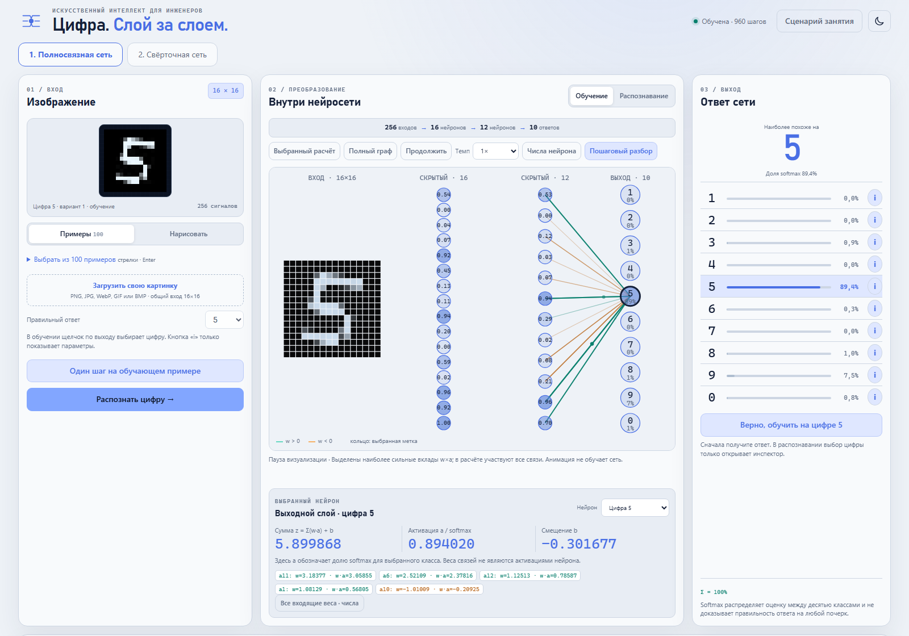
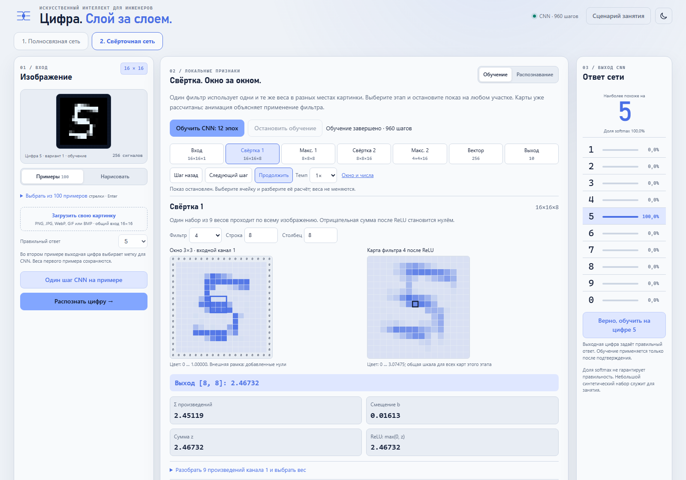

# Инструкция для слушателя: лаборатория «Цифра. Слой за слоем»

Лаборатория показывает изнутри, как нейросеть узнаёт нарисованную цифру и как она этому учится. Вы рисуете цифру, сеть отвечает, а на экране видно, что происходит на каждом шаге: какие числа приходят в нейроны, как из них получается ответ и что меняется после обучения. Установка не нужна, достаточно браузера.

Открыть: **https://neural-network-digit-recognition.pikov.expert/**

С чего начать: [первые шаги за 10 минут](#первые-шаги-за-10-минут), потом [опыты для самопроверки](#опыты-для-самопроверки). Непонятное слово – в [словарике](#словарик).

## Что на экране

### Три части экрана

Экран разделён на три части. Сигнал идёт по ним слева направо.

| Часть | Что там |
|---|---|
| **01 / Вход** (слева) | Холст для рисунка, 100 готовых примеров и загрузка своей картинки. Перед подачей в сеть программа обрезает пустые края рисунка, масштабирует его и ставит в центр поля 16 × 16 клеток. Каждая клетка – одно число, всего 256 чисел |
| **02 / Преобразование** (в центре) | Сама нейросеть: слои, связи, числа внутри нейронов |
| **03 / Выход** (справа) | Ответ сети: десять цифр `1 … 9, 0` и доля уверенности для каждой |

Обучение на всём наборе, история обучения и кнопки сохранения у полносвязной сети – под основной частью экрана, у свёрточной – в центральной части.

### Переключатели и кнопки вверху

- **«1. Полносвязная сеть»** и **«2. Свёрточная сеть»** – две сети, устроенные по-разному. Рисунок общий, а знания у каждой сети свои: обучение одной не меняет другую. Как они устроены – в разделах [полносвязная сеть изнутри](#полносвязная-сеть-изнутри) и [свёрточная сеть изнутри](#свёрточная-сеть-изнутри).
- **«Обучение»** и **«Распознавание»** (в центральной части) – в режиме «Распознавание» сеть только отвечает, обучение выключено, и случайным щелчком её не испортить.
- **«Крупно»** увеличивает весь интерфейс – удобно на большом экране. **«Сценарий занятия»** – короткая памятка, что и в каком порядке показывать. **«Инструкция»** открывает эту страницу.

## Первые шаги за 10 минут

1. **Посмотрите на необученную сеть.** Если у сети вверху написано «Случайные веса» (у свёрточной – «CNN · случайные веса»), она ещё ничего не знает. Нажмите **«Нарисовать»**, нарисуйте мышью крупную цифру и нажмите **«Распознать цифру»**. Ответ зависит только от случайных весов, доли у цифр могут быть какими угодно. Сеть уже собрана, но ничего не знает: знания появятся только после обучения.
2. **Научите сеть на одном примере.** Если ответ неверный, щёлкните правильную цифру справа и подтвердите **«Да, обучить»** (у свёрточной сети – **«Да, обучить CNN»**). Если ответ верный – нажмите **«Верно, обучить на цифре N»**. Это ровно один шаг обучения. Пока вы не подтвердили, сеть не меняется, а «Отмена» оставляет её как была. Что происходит при этом шаге – в разделе [как сеть учится](#как-сеть-учится).
3. **Проверьте, что изменилось.** Снова нажмите «Распознать цифру». Доля правильной цифры выросла. Но по одному примеру всему не научишься: на другом рисунке сеть может ошибиться.
4. **Обучите сеть на наборе.** Нажмите **«Быстро обучить: 12 эпох»**. Сеть пройдёт 12 раз по 80 обучающим примерам. Ещё 20 примеров отложены: на них сеть не учится, по ним проверяют, как она справляется с незнакомыми картинками. В истории видно, как падает ошибка (loss) и растёт доля верных ответов. Повторное нажатие продолжает обучение той же сети, а не начинает его заново.
5. **Нажмите «Очистить холст», нарисуйте свою цифру ещё раз** и сравните ответ с тем, что было до обучения.
6. **Повторите то же для свёрточной сети:** переключитесь на «2. Свёрточная сеть», нажмите «Распознать цифру», затем **«Обучить CNN: 12 эпох»**.

Обученную модель можно сохранить в файл и вернуть – см. [сохранение модели](#сохранение-модели).

## Полносвязная сеть изнутри

### Как проходит сигнал

Рисунок превращается в 256 чисел – по одному на клетку. Дальше сигнал проходит через слои: **256 входов, затем слои из 16 и 12 нейронов, на выходе 10 ответов**.

- **Нейрон** берёт все числа предыдущего слоя, умножает каждое на свой **вес** (`w`), складывает и добавляет **смещение** (`b`). Получается сумма `z`.
- В двух скрытых слоях (16 и 12 нейронов) сумма проходит через **функцию активации** sigmoid: она сжимает любое число в промежуток от 0 до 1. Результат `a` – это сигнал нейрона для следующего слоя.
- На выходе десять сумм вместе превращаются в **доли softmax**: в сумме они дают 100 %, и сеть называет цифру с наибольшей долей.

Всего в этой сети 4 408 весов и 38 смещений, вместе 4 446 чисел. Всё, что сеть «знает», хранится в этих числах, и больше нигде.

### Как посмотреть числа нейрона

Нажмите **«i»** рядом с любой выходной цифрой: появятся сумма `z`, доля softmax, смещение `b` и пять связей с самым большим вкладом. Цвет связи на графе показывает знак веса (обозначения `w > 0` и `w < 0` – в нижнем левом углу графа): положительный вес усиливает сигнал, отрицательный ослабляет. Анимация после распознавания только показывает, как идёт сигнал, а веса не меняет.

### Как сеть учится

Сеть сравнивает свой ответ с правильным и считает **ошибку (loss)**. Затем для каждого веса вычисляет **градиент** – насколько быстро и в какую сторону растёт ошибка, если этот вес увеличить. Чтобы ошибка уменьшилась, вес сдвигают в обратную сторону на маленький шаг: `w ← w − η · градиент`, где `η` – скорость обучения.

### Пошаговый разбор

Расчёт одного шага обучения можно пройти по этапам. Распознайте рисунок и нажмите **«Пошаговый разбор»**. Сначала проверьте поле **«Правильная цифра для обучения»**: для своего рисунка там по умолчанию стоит ответ сети, а он может быть неверным. Для готового примера из набора поле заполнено правильной цифрой и не меняется.

Затем пройдите шесть этапов: вход, сумма, активация, ошибка, градиент, новый вес. На экране показан расчёт для одной выбранной связи, а кнопка **«Применить один шаг»** обновляет все веса и смещения сети. Пока она не нажата, сеть не меняется.

## Свёрточная сеть изнутри

### Фильтры

Свёрточная сеть смотрит на картинку через маленькое окно 3 × 3 клетки, которое скользит по всему рисунку. У окна 9 весов, и одни и те же веса работают во всех местах картинки. Такое окно называют **фильтром**: обученный фильтр откликается на свой признак – вертикальный штрих, угол, изгиб – где бы он ни находился.

### Слои по порядку

1. **Свёртка 1** – 8 фильтров 3 × 3, получается 8 карт признаков 16 × 16. После свёртки отрицательные значения заменяются нулём, положительные остаются как есть (функция ReLU).
2. **Максимум 1** (на кнопке – «Макс. 1») – из каждых четырёх соседних клеток остаётся наибольшее значение, карта уменьшается вдвое: 8 × 8.
3. **Свёртка 2** – 16 фильтров; каждый смотрит сразу на все 8 карт первого слоя. После неё – снова ReLU.
4. **Максимум 2** – ещё одно уменьшение вдвое: 4 × 4.
5. **Разворачивание** (на кнопке – «Вектор») – 16 карт 4 × 4 выстраиваются в одну строку из 256 чисел.
6. **Выход** – 10 ответов с долями softmax.

Выберите этап, фильтр и клетку – будут видны окно, произведения его чисел на веса фильтра, сумма и результат.

### Чем она отличается от полносвязной

Параметров у свёрточной сети даже меньше, чем у полносвязной, – 3 818. На этом учебном наборе она обычно точнее: после сброса и 12 эпох полносвязная сеть узнаёт 15 из 20 проверочных примеров, свёрточная – все 20. Одна из причин – свёрточная сеть ищет одни и те же мелкие признаки по всей картинке. На ваших собственных рисунках результат может быть другим, проверьте это в [опыте 2](#опыт-2-две-сети-на-равных).

## Сохранение модели

Сеть работает прямо в вашем браузере: рисунок и модель на сервер не отправляются. Онлайн-версия, как и весь сайт pikov.expert, считает посещения и переходы по ссылкам.

Рисунок живёт только на открытой странице и после её перезагрузки пропадает. Обученные модели браузер сохраняет сам, если это разрешено в его настройках, и покажет их при следующем открытии лаборатории с того же адреса. Если лаборатория сообщит, что сохранить модель не удалось, сохраните её в файл.

Кнопки сохранения у каждой сети свои:

| Что сделать | Полносвязная сеть | Свёрточная сеть |
|---|---|---|
| Вернуть случайные веса | «Сбросить» | «Сбросить CNN» |
| Сохранить модель в файл | «Экспорт» | «Экспорт CNN» |
| Загрузить модель из файла | «Импорт» | «Импорт CNN» |

В файл попадает только модель, рисунок не сохраняется.

## Опыты для самопроверки

В каждом опыте есть вопрос. Попробуйте и ответьте на него сами. Новые штрихи добавляются к прежним, поэтому перед каждой новой цифрой нажимайте **«Очистить холст»**. Чтобы сравнить две сети, давайте им один и тот же рисунок.

### Опыт 1. Как программа видит рисунок

Нарисуйте цифру маленькой в углу холста и посмотрите на поле 16 × 16, которое уходит в сеть. Где оказалась цифра и какого она размера? Почему программа так делает? Подсказка – в разделе [три части экрана](#три-части-экрана).

### Опыт 2. Две сети на равных

Сбросьте обе сети и обучите каждую по 12 эпох. Нарисуйте несколько своих цифр. Какая сеть чаще отвечает правильно?

### Опыт 3. Толщина и наклон

Нарисуйте одну и ту же цифру тонко, толсто, с наклоном. Как меняются доли softmax?

### Опыт 4. Не цифра

Нарисуйте букву или крестик. Что ответит сеть? Значит ли доля 90 %, что ответ правильный?

### Опыт 5. Один шаг

Возьмите необученную сеть и несколько раз подряд обучите её на одном и том же рисунке. Что станет с ответами на другие цифры?

### Опыт 6. Обучающие и проверочные примеры

В истории эпох сравните точность на обучении (Train) и на проверке (Validation). Почему на проверке она обычно ниже?

### Опыт 7. Внутри нейрона

Нажмите «i» у выходной цифры, которую назвала полносвязная сеть. Какие связи влияют на неё сильнее всего? Где смотреть – в разделе [как посмотреть числа нейрона](#как-посмотреть-числа-нейрона).

## Частые вопросы

### Почему моя цифра распознаётся неправильно, хотя точность 75 %?

75 % – доля верных ответов на 20 отложенных примерах этого набора. Ваш рисунок может сильно отличаться от них толщиной, наклоном, формой.

### Сеть «уверена на 99 %» – значит, ответ правильный?

Нет. Softmax всегда делит 100 % между десятью цифрами, которые знает сеть. На букве или крестике сеть тоже уверенно назовёт какую-нибудь цифру. Пустой холст лаборатория распознавать не даёт.

### Почему после обучения на моём рисунке другие цифры стали распознаваться хуже?

Один шаг подстраивает веса под один пример. Чтобы сеть узнавала разные рисунки, нужны эпохи на многих примерах.

### Почему свёрточная сеть на этом наборе точнее?

Она ищет одни и те же признаки (штрихи, углы) по всей картинке. Но это результат на маленьком учебном наборе, а не правило для любых рисунков.

### На каких примерах учится сеть?

В наборе 100 картинок 16 × 16: на 80 сеть учится, 20 отложены для проверки. Картинки создала программа лаборатории: по десять вариантов каждой цифры, с разными сдвигами, наклонами, толщиной и шумом. Это маленький учебный набор, поэтому высокая точность на нём не значит, что сеть узнает любой почерк.

### Где тут «интеллект»?

Только в настроенных числах-весах. Большие языковые модели устроены по тем же принципам, но параметров у них в миллионы раз больше.

## Словарик

| Слово | Что значит |
|---|---|
| Нейрон | Узел сети: складывает входящие сигналы с весами и пропускает сумму через функцию активации. См. [как проходит сигнал](#как-проходит-сигнал) |
| Вес (`w`) | Число на связи между нейронами: насколько сильно и в какую сторону сигнал влияет на следующий нейрон |
| Смещение (`b`) | Добавка к сумме нейрона, сдвигает порог его срабатывания |
| Функция активации | Превращает сумму нейрона в его выходной сигнал. Здесь это sigmoid (в скрытых слоях полносвязной сети) и ReLU (после свёрток) |
| Softmax | Превращает десять выходных чисел в доли, которые в сумме дают 100 % |
| Ошибка (loss) | Число, которое показывает, насколько ответ сети далёк от правильного |
| Градиент | Показывает, как растёт ошибка при изменении веса. При обучении вес сдвигают в обратную сторону. См. [как сеть учится](#как-сеть-учится) |
| Эпоха | Один проход обучения по всем обучающим примерам |
| Фильтр (свёртка) | Окно с весами, которое скользит по картинке и находит свой признак. См. [фильтры](#фильтры) |
| Обучающие и проверочные примеры | На первых сеть учится, по вторым проверяют, как она справляется с незнакомыми картинками |

Другие термины курса простыми словами – в [глоссарии курса «Искусственный интеллект для инженеров»](https://kamaz-ai.pikov.expert/glossary.html).

## Если что-то не работает

| Что случилось | Что сделать |
|---|---|
| Мелкие подписи | Кнопка «Крупно» вверху или масштаб браузера: Ctrl и «+» |
| Сеть после опытов отвечает странно | Нажмите «Сбросить» («Сбросить CNN») у нужной сети и обучите её заново или загрузите сохранённую модель через «Импорт» («Импорт CNN») |
| Нет обученной модели на другом компьютере, в другом браузере или по другому адресу | Модель хранится в браузере и привязана к адресу лаборатории. Перенести можно через «Экспорт» и «Импорт», у каждой сети отдельно. См. [сохранение модели](#сохранение-модели) |
| Нет интернета | Лабораторию можно запустить на своём компьютере без интернета, инструкция – в [README репозитория](https://github.com/pikov-vitaliy/neural-network-digit-recognition#readme) |
